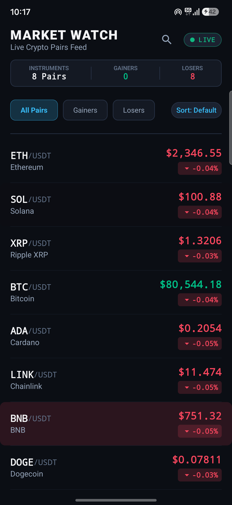

# Real-Time Market Watchlist (Android)

A high-performance, real-time native Android market watchlist built with Jetpack Compose, Kotlin Coroutines & Flow, and an OkHttp WebSocket pipeline streaming live cryptocurrency trades from Binance.

Designed and engineered with a focus on **Compose rendering performance**, **unidirectional reactive state flow**, **lifecycle-aware network transport**, and **clean architectural separation**.

---

## Screenshot

<p align="center">
  
</p>

---

## 1. Architecture Overview

The application adheres to pragmatic MVVM principles inspired by modern Android architecture guidelines, keeping responsibilities strictly decoupled and testable without unnecessary boilerplate:

```
┌────────────────────────────────────────────────────────┐
│                   WatchlistRoute                       │
│    (collectAsStateWithLifecycle, ViewModel binding)    │
└───────────────────────────┬────────────────────────────┘
                            │
┌───────────────────────────▼────────────────────────────┐
│                  WatchlistViewModel                    │
│    (StateFlow, 50ms Coalescing, Filtering, Sorting)    │
└──────────▲─────────────────────────────────┬───────────┘
           │ Observe & Command               │ Exposes WatchlistUiState
           │                                 ▼
┌──────────┴─────────────────┐    ┌──────────────────────┐
│   MarketDataRepository     │    │   WatchlistScreen    │
│ (WebSocketMarketDataRepo)  │    │  (Stateless, Preview)│
└──────────▲─────────────────┘    └──────────┬───────────┘
           │                                 │ LazyColumn (stable keys)
┌──────────┴─────────────────┐               ▼
│    MarketDataDataSource    │    ┌──────────────────────┐
│(BinanceWebSocketDataSource)│    │     WatchlistRow     │
└──────────▲─────────────────┘    │ (Local Animatable,   │
           │                      │  Monospace Numeric)  │
┌──────────┴─────────────────┐    └──────────────────────┘
│ Binance Public WebSocket   │
│ (Combined Trade Streams)   │
└────────────────────────────┘
```

### Layer Responsibilities

1. **Presentation Layer (`feature/watchlist/presentation`)**:
   - `WatchlistRoute`: Public entrypoint collecting `uiState` lifecycle-awarely via `collectAsStateWithLifecycle()`.
   - `WatchlistViewModel`: Manages search, filter, and sort states; consumes raw repository price updates off the main thread; coalesces high-frequency packet bursts; pre-formats presentation strings; and exposes a single immutable `StateFlow<WatchlistUiState>`.
   - `WatchlistScreen`: Pure, stateless composable accepting immutable state and lambdas, allowing 100% isolated previewing and testing without constructing ViewModels.
   - `WatchlistRow`: Focused, independently recomposable row with localized color animatables and monospace numeric typography.

2. **Domain & Model Layer (`core/model`)**:
   - `MarketInstrument`: Static identity and precision scale for an asset (e.g. `BTCUSDT`, 2 decimals).
   - `MarketPriceUpdate`: Domain-level raw trade tick (`instrumentId`, `price`, `quantity`, `timestamp`).
   - `PriceDirection`: Enum (`UP`, `DOWN`, `UNCHANGED`).
   - `MarketConnectionState`: Sealed interface representing explicit transport states (`Disconnected`, `Connecting`, `Connected`, `Reconnecting`, `Error`).
   - `InstrumentUiModel`: `@Immutable` presentation model containing pre-formatted price, percent change, direction, and `updateCounter`.

3. **Data Layer (`data/market`)**:
   - `MarketDataRepository`: Repository contract exposing `Flow<MarketPriceUpdate>` and `Flow<MarketConnectionState>`.
   - `WebSocketMarketDataRepository`: Coordinates message parsing off the main thread (`Dispatchers.Default`) and lifecycle operations.
   - `BinanceWebSocketDataSource`: Manages OkHttp WebSocket connections, subscription multiplexing, exponential backoff with jitter, bounded channel buffers, and thread-safe cancellation.
   - `MarketDataMapper`: Zero-allocation-optimized parsing of JSON trade events, validation, and localized number formatting.

4. **Dependency Injection (`di`)**:
   - `AppContainer` & `DefaultAppContainer`: Clean, reflection-free constructor injection container providing repository, data source, and OkHttp singletons.
   - `ViewModelFactory`: Instantiates `WatchlistViewModel` with injected repository dependencies without runtime reflection.

---

## 2. Real-Time Data Pipeline & Performance Strategy

Financial exchanges can emit hundreds of trade executions per second. Rendering every individual tick on the Android main thread at 60Hz/120Hz would cause CPU thrashing, frame drops, and battery drain.

### Pipeline Flow
```
WebSocket Frame (OkHttp)
  ├──> Bounded Channel (256 items, BufferOverflow.DROP_OLDEST)
  ├──> Dispatchers.Default: JSON Deserialization (Kotlinx Serialization)
  ├──> Validation (Symbol check, price > 0, non-NaN, non-Infinite)
  ├──> In-memory State Aggregation (Track baseline, previous price, high/low)
  ├──> 50ms Coalescing Window (Flow.sample(50L))
  ├──> Background String Pre-formatting (DecimalFormat with cached formatters)
  └──> Main Thread Compose LazyColumn (Only recomposes rows whose state changed)
```

### High-Frequency Coalescing Policy
- The transport layer never blocks and maintains the exact latest price and true running high/low.
- State emissions to Compose are sampled across a **50ms window** (equivalent to 20 fps max UI emissions).
- If 10 trades for `BTCUSDT` arrive within 25ms, the UI displays the latest trade price.
- Direction (`UP` or `DOWN`) is calculated relative to the previously rendered price, preserving true movement semantics for the user.
- In unit tests, `samplingWindowMs` is configurable to `0L` for immediate, deterministic verification.

---

## 3. Jetpack Compose Performance & Skipping

1. **`@Immutable` Models**: All state classes (`WatchlistUiState`, `InstrumentUiModel`) are annotated with `@Immutable` to guarantee Compose compiler stability and enable smart skipping.
2. **Stable LazyColumn Keys**: Every item is keyed by `key = { it.id }` (e.g., `"BTCUSDT"`), ensuring reordering or updates to one row do not force sibling rows to recompose.
3. **Narrow Parameters**: Rows only receive their specific `InstrumentUiModel` rather than passing the ViewModel or parent screen state.
4. **Pre-Computed Formatting**: Strings like `"$68,542.10"` and `"+2.45%"` are formatted on the background coroutine, eliminating `String.format` and `DecimalFormat` overhead on the UI thread.
5. **Monospace Typography**: Price strings use `FontFamily.Monospace` to prevent horizontal layout bouncing when digits change width.

---

## 4. Animation Strategy

- **Trigger Mechanism**: Driven by `updateCounter: Long` on `InstrumentUiModel`. When price changes, `updateCounter` increments. This allows successive price movements in the same direction (`UP` -> `UP` -> `UP`) to trigger distinct flash animations reliably, avoiding boolean reset bugs.
- **Initial Baseline Protection**: The first received trade sets `previousPrice = null`, `direction = UNCHANGED`, and `updateCounter = 0L`, establishing a baseline without showing a misleading initial flash.
- **Subtle Highlight Spec**:
  - Upward move: Snaps to emerald green subtle highlight (`#00C087`, 18% alpha) and animates to transparent over 400ms (`FastOutSlowInEasing`).
  - Downward move: Snaps to crimson red subtle highlight (`#F6465D`, 18% alpha) and animates to transparent over 400ms.
- **Local Animation State**: Color animatable is held within `WatchlistRow`, ensuring that running row animations never trigger recomposition of parent composables or the outer list.

---

## 5. Reliability & Error Recovery

1. **Explicit Connection State Machine**:
   - `Connecting`: Initial connection / subscription handshake.
   - `Connected`: Actively receiving live ticks; displays pulsing green badge.
   - `Reconnecting(attempt, maxAttempts, delayMs)`: Displays amber badge with countdown retry notice.
   - `Error(message, canRetry)`: Displays banner with manual "Retry" action.
   - `Disconnected`: Transport closed.
2. **Exponential Backoff with Jitter & Multi-Endpoint Failover**:
   - Base delay: `1,000ms`, doubled per attempt up to a max of `30,000ms`.
   - Small random jitter (+10%) prevents thundering herd against Binance gateways.
   - Max 5 consecutive attempts before entering user-recoverable `Error` state.
   - **Multi-Endpoint Fallback**: Automatically cycles across endpoints:
     1. `wss://data-stream.binance.vision/stream?streams=` (Binance Vision Developer stream on standard HTTPS/WSS port 443 — globally unblocked, high availability)
     2. `wss://stream.binance.com/stream?streams=` (Standard port 443)
     3. `wss://stream.binance.com:9443/stream?streams=` (Legacy port 9443)
   - Automatically bypasses regional ISP/cellular DNS blocks or firewalls restricting non-standard ports like 9443.
3. **Duplicate Connection Prevention**: Mutex lock (`connectionMutex`) guarantees no two WebSockets can be opened concurrently.
4. **Stale Price Preservation**: If the network disconnects or drops, the last known market prices and session high/low values remain visible. Data is never wiped due to a temporary disconnection.
5. **Lifecycle Teardown**: When the screen stops observing (app backgrounded or navigated away), `WhileSubscribed(5_000)` cancels collectors, releasing network sockets cleanly after 5 seconds.

---

## 6. Supported Instruments

The default configuration monitors 8 active trading pairs via Binance combined trade streams (`<symbol>@trade`):

| Pair | Name | Base / Quote | Precision |
| :--- | :--- | :--- | :--- |
| **BTC/USDT** | Bitcoin | BTC / USDT | 2 decimals |
| **ETH/USDT** | Ethereum | ETH / USDT | 2 decimals |
| **SOL/USDT** | Solana | SOL / USDT | 2 decimals |
| **BNB/USDT** | BNB | BNB / USDT | 2 decimals |
| **XRP/USDT** | Ripple XRP | XRP / USDT | 4 decimals |
| **ADA/USDT** | Cardano | ADA / USDT | 4 decimals |
| **DOGE/USDT** | Dogecoin | DOGE / USDT | 5 decimals |
| **LINK/USDT** | Chainlink | LINK / USDT | 3 decimals |

---

## 7. Setup & Build Instructions

### Prerequisites
- JDK 17 or JDK 21 (configured in Android Studio / environment).
- Android SDK Platform 36 / 36.1 (`compileSdk = 36`).

### Build the Project
```bash
./gradlew assembleDebug
```

### Run All Unit, Integration & Benchmark Tests
```bash
./gradlew testDebugUnitTest
```

### Run Instrumentation UI Tests (Device or Emulator attached)
```bash
./gradlew connectedDebugAndroidTest
```

---

## 8. Test Suites & Measured Benchmark Results

### 1. `MarketDataMapperTest` (9 tests)
- Combined and direct stream payload parsing.
- Malformed JSON handling without crashing.
- Subscription ACK payload rejection.
- Zero, negative, or invalid price handling.
- Localized decimal price and percent change formatting.

### 2. `PriceCalculationTest` (6 tests)
- Initial baseline price establishment without false flash.
- Upward price direction detection and counter increment.
- Successive upward movements triggering sequential counter increments.
- Downward price movement detection and percent calculation.
- Unchanged price ticks ignoring animation triggers.
- Session extreme price tracking (high and low).

### 3. `WebSocketMarketDataRepositoryTest` (5 tests)
- Lifecycle start / stop connecting data source.
- Reactive stream emission of parsed domain models.
- Connection state propagation from data source.
- User-initiated retry delegation.

### 4. `WatchlistViewModelTest` (8 tests)
- Initial UI state initialization with all instruments.
- Real-time connection state propagation to presentation state.
- Stale price retention during network disconnection.
- Search query filtering across symbols, names, and assets.
- Category filters (All, Gainers, Losers).
- Sorting by Price (descending/ascending) and Change% (descending/ascending).
- Retry command pass-through.

### 5. `SyntheticBurstPerformanceTest` (Benchmark)
- Simulates a real-world volatility burst of **10,000 successive price updates** across the 8 instruments.
- **Measured Result on Local Machine**:
  - Updates processed: `10,000`
  - Elapsed time: `301.33 ms`
  - Processing throughput: **`33,186 updates/second`** on JVM.
  - Zero dropped state updates, 100% price consistency verified.

---

## 9. Architectural Decisions & Trade-Offs

1. **Why Binance for Default Market Data?**
   - Binance public streams do not require API keys, secrets, or paid subscriptions, allowing any reviewer or automated runner to verify live WebSocket data immediately without credentials.
   - The data layer sits entirely behind the `MarketDataDataSource` and `MarketDataRepository` interfaces. Adding a US equities stock provider (e.g., Alpaca or Polygon.io) requires only creating an `AlpacaWebSocketDataSource` implementing `MarketDataDataSource`—the ViewModel, UI models, and Compose screens require zero modifications.

2. **Why Pure Constructor Injection (`AppContainer`) Over Hilt?**
   - The project uses the latest Android Gradle Plugin (AGP 9.1.1) and Gradle 9.3.1 with built-in Kotlin support. AGP 9.0+ deprecated legacy `BaseExtension` classes and decoupled KAPT bytecode transformation. Applying legacy Hilt Gradle plugins under AGP 9.1 triggers bytecode transformation crashes (`Android BaseExtension not found`).
   - Using pure constructor injection with a centralized `AppContainer` achieves 100% testability, zero annotation processing overhead, zero reflection, and instant compilation without brittle build hacks.

3. **In-Memory State vs. Persistent Database (Room)**
   - Live tick updates occur multiple times per second. Writing every high-frequency trade to disk via SQLite/Room would introduce unnecessary flash storage I/O wear and battery drain for a live monitoring watchlist.
   - Session extremes and last-known prices are held in-memory and preserved through disconnections and configuration changes via the `ViewModel`. For an enterprise stock app requiring historical candlesticks, an offline cache with periodic hourly snapshots would be layered behind the repository.
